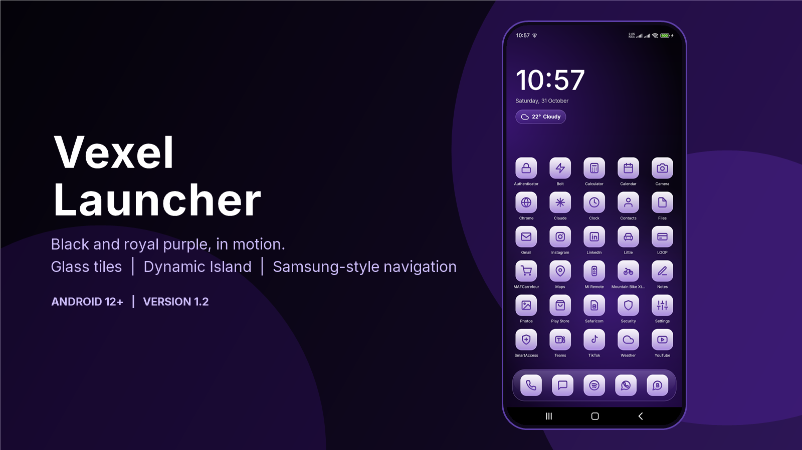
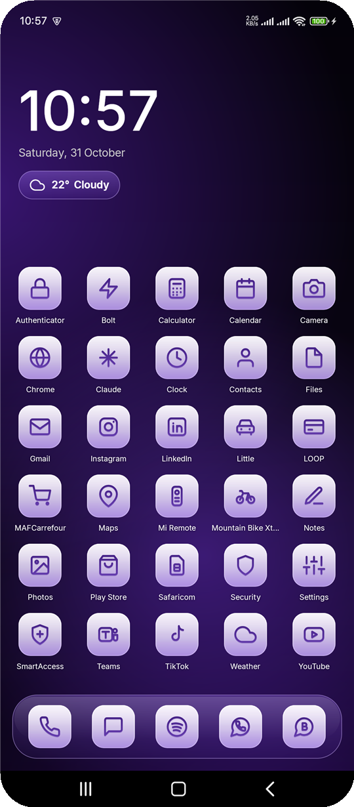
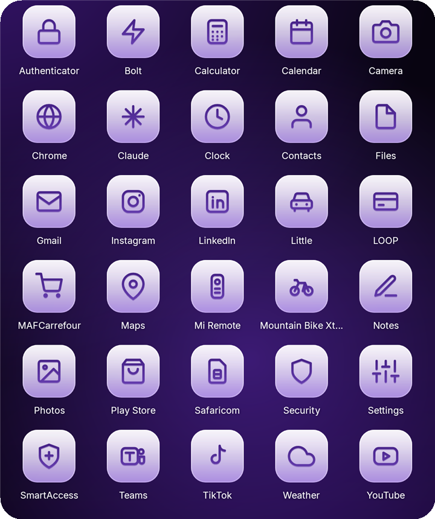

<p align="center">
  
</p>

<p align="center">
  <a href="https://github.com/octocatblain/vexel/releases/latest/download/vexel-launcher.apk"></a>
  <a href="https://github.com/octocatblain/vexel/releases"></a>
  <a href="https://github.com/octocatblain/vexel/issues"></a>
</p>

<p align="center">
  
  
  
  
  
</p>

# Vexel Launcher

A custom Android home screen: a black and royal-purple background in slow motion, frosted-glass app tiles
with a purple outlined icon set, an iPhone-style Dynamic Island, and a Samsung-style navigation bar.
Built for a Xiaomi phone (HyperOS, Android 15); needs Android 12 or newer.

> Version 1.2 is published as a [GitHub release](https://github.com/octocatblain/vexel/releases/tag/v1.2); the download
> counter above counts downloads of the attached `vexel-launcher.apk`.

## Screenshots

<table>
  <tr>
    <td align="center"><br><sub><b>One page.</b> Clock, date and weather; every app below; favourites docked.</sub></td>
    <td align="center"><br><sub><b>One icon set.</b> 24-unit grid, 2-unit stroke, glass tiles.</sub></td>
  </tr>
  <tr>
    <td colspan="2" align="center"><br><sub><b>Navigation bar.</b> Recents, home, back: four equal gaps, in every app.</sub></td>
  </tr>
</table>

## Install

1. **Download** `vexel-launcher.apk` with the button above, on your phone.
2. **Install it.** Open the file and allow "Install unknown apps" for your browser or file manager when asked.
   Google Play Protect may say it hasn't seen the app before; choose *More details → Install anyway*.
3. **Make it your home app.** Press Home and pick *Vexel Launcher → Always*.

Optional power features (the island, the self-healing navigation bar) need a one-time `adb` setup. See
[One-time phone setup](#one-time-phone-setup).

### Check your download

```
SHA-256  26137126c53c929a3c241909b807e93d06378827de6ddb1c4eb43e8b0a42cd08
Size     5.19 MB   Version 1.2 (code 3)   Signed with the Vexel release key
```

## Highlights

| Feature | What you get |
| --- | --- |
| One page | Clock, date and weather at the top; every app in a five-column grid that hugs the bottom; favourites docked underneath. Apps on the dock aren't repeated in the grid |
| Tap the header | Tap the time to open Clock, the date to open Calendar, the weather to open Weather. Swipe down from the header to pull the notification shade |
| Scrolling | Up to 35 apps fit without scrolling. With more, the grid scrolls under invisible edges just below the header and just above the dock, fading softly. Press Home to jump back to the top |
| Favourites | Phone, Messages, Spotify, WhatsApp and WA Business by default. Long-press any app to add or remove (up to five) |
| Icon set | Outlined glyphs chosen by what an app does, with logo-shaped glyphs for Spotify, WhatsApp, TikTok, LinkedIn and others. See [DESIGN.md](DESIGN.md) |
| Moving backdrop | Three royal-purple glows drift over black. It animates only while the launcher is visible |
| Dynamic Island | A black pill under the camera. Shows Spotify (or any media) with art, progress and controls, plus alarms, calls, timers, navigation and ride apps such as Bolt. Tap to expand, swipe to switch activities. Visible only while the launcher is on screen |
| Navigation bar | A Samsung-style bar (recents, home, back) drawn over the system buttons in every app |
| Lock screen | A custom lock screen drawn over the system keyguard. Built, **not yet verified on a device** |
| Weather | Open-Meteo at your coarse location, no API key |
| Type | Inter (SIL OFL), the open-source face closest to Apple's San Francisco |

## What's new in 1.2

- One-page home with the grid anchored to the bottom, scrolling under soft edges when there are more than 35 apps.
- Lavender-glass app tiles with deep-purple outlined glyphs, logo-shaped glyphs for the big brand apps, and a
  translucent favourites dock. The dock apps are no longer repeated in the grid.
- Black and royal-purple backdrop that drifts slowly, only while the launcher is on screen.
- Samsung-style navigation bar with four equal gaps and a square home button. It restores itself after you clear apps.
- Inter replaces the system font; the clock is 80sp Medium.
- Tap the time, date or weather to open Clock, Calendar or Weather.
- Dynamic Island with refined transport controls, and a custom lock screen (the lock screen is still unverified).

Removed in this version: the search bar, the extra pages and the alarm and calendar lines beside the clock.

## One-time phone setup

Turn on USB debugging, then:

```
adb install -r vexel-launcher.apk

adb shell cmd role add-role-holder --user 0 android.app.role.HOME com.vexel.launcher   # default home app
adb shell cmd notification allow_listener com.vexel.launcher/com.vexel.launcher.IslandListenerService
adb shell pm grant com.vexel.launcher android.permission.WRITE_SECURE_SETTINGS
adb shell dumpsys deviceidle whitelist +com.vexel.launcher                                # battery limits
```

Open the launcher once; it switches on its own navigation service. Weather asks for location the first time.
For the lock screen also run:

```
adb shell pm grant com.vexel.launcher android.permission.POST_NOTIFICATIONS
adb shell cmd appops set com.vexel.launcher USE_FULL_SCREEN_INTENT allow
```

### Switching back

- Press Home and choose Xiaomi's launcher, or run
  `adb shell cmd role add-role-holder --user 0 android.app.role.HOME com.miui.home`.
- Turn off the navigation bar in Settings → Accessibility → Installed apps → Vexel navigation bar.
- Take back the extra permission: `adb shell pm revoke com.vexel.launcher android.permission.WRITE_SECURE_SETTINGS`.
- Uninstall Vexel like any other app. Nothing it does needs root, so nothing is left behind.

### Xiaomi quirks

- **USB installs** are blocked intermittently with `INSTALL_FAILED_USER_RESTRICTED`. Turn **Install via USB** off
  and on in Developer options, keep the screen on and unlocked, or install the APK from a file manager.
- **`adb push` from Git Bash** rewrites `/sdcard/...` into a Windows path and silently saves nothing. Use
  `MSYS_NO_PATHCONV=1` or PowerShell.
- **Default home app.** Reinstalling can reset it to Xiaomi's launcher. Re-run the `add-role-holder` command.

## Navigation bar

`NavBarService` is an accessibility service. It draws a black bar over the system navigation buttons at the
same height and presses the real recents, home and back actions. It never reads the screen. The three buttons
sit in equal gaps (screen edge, recents, home, back, screen edge), and each takes a third of the bar for touch.

- Turn it off in Settings → Accessibility → Installed apps → Vexel navigation bar. Xiaomi's own buttons return.
- Clearing apps force-stops Vexel, which switches the service off. Because Vexel is the home app it restarts at
  once and re-enables the service in `MainActivity.ensureNavBarEnabled()`. That needs the
  `WRITE_SECURE_SETTINGS` grant above; without it the bar must be re-enabled by hand.
- The bar hides on the lock screen. It may stay visible over full-screen apps and videos.

### Why not gestures

Xiaomi's full-screen gestures run through Xiaomi's own launcher, so with Vexel as the home app they show the
bar but don't respond. Android's standard gesture overlay didn't work on this phone either. The phone stays on
three-button navigation, replaced visually by the bar above.

## Lock screen

`LockService` runs as a foreground service. When the screen turns on while locked it posts a full-screen
notification that opens `LockScreenActivity` over the keyguard: clock, weather, island, torch, camera, and
swipe up to unlock. Unlocking asks the system to dismiss the keyguard, so a PIN or fingerprint is still
required. It cannot replace the real lock screen, and Xiaomi may need Autostart and background pop-ups allowed
for it to appear.

## Build

Requires the Android SDK and the JDK that ships with Android Studio.

```
set JAVA_HOME=C:\Program Files\Android\Android Studio\jbr
gradlew.bat assembleDebug      # debug-signed
gradlew.bat assembleRelease    # signed with signing/vexel-release.jks
```

Outputs are in `app/build/outputs/apk/{debug,release}/`. Copy the release APK to `dist/vexel-launcher.apk`
(git-ignored) and attach it to a GitHub release under that exact name, so the download button works.

The project uses Android Gradle Plugin 9.0.0 and Gradle 9.6.0, because Android Studio's bundled JDK is version
25 and older Gradle versions cannot read it. Kotlin comes from the AGP built-in support.

### Signing

Release builds are signed with `signing/vexel-release.jks`, configured through `signing/keystore.properties`.
Both are git-ignored. **Back them up**: an update installs over an existing copy only if it is signed with the
same key. A copy signed with a different key (such as the debug key) has to be uninstalled first.

## Project layout

```
app/src/main/java/com/vexel/launcher/
  MainActivity.kt          home screen, dock, grid, weather, gestures
  Glyphs.kt                the icon set and the app-to-glyph mapping
  Ui.kt                    design tokens, glass drawables, animated Backdrop
  Fonts.kt                 Inter weights
  IslandView.kt            the Dynamic Island view
  IslandRepository.kt      media sessions and notifications feeding the island
  IslandListenerService.kt notification access
  NavBarService.kt         Samsung-style navigation bar
  LockService.kt           lock screen trigger
  LockScreenActivity.kt    the lock screen
  BootReceiver.kt          restarts the lock service after boot
  Weather.kt               Open-Meteo client
app/src/main/res/font/     Inter Medium, Regular, Bold
docs/images/               README images
licenses/Inter-OFL.txt     font licence
DESIGN.md                  design rules and metaphor map
```

## Known limits

- The island appears only while the launcher is on screen, not over other apps.
- Alarms, calls, timers and ride notifications are wired up but have not been exercised on the device. Spotify
  has. There is no island screenshot yet for the same reason: it needs music playing.
- The lock screen has not been verified on a device.
- The scrolling layout with more than 35 apps was checked on a device with extra entries added for the test, and
  the bottom edge fade showed. Touch scrolling itself has not been exercised, and it has not been used with that
  many real apps.
- Android hands ordinary apps only the next alarm (the rest of Xiaomi's alarm list needs a permission apps can't
  get), so the launcher does not list upcoming alarms on the home screen.
- Removed system apps (Gemini, Game Center, Mi Video, File Manager, Gallery, Downloads, Themes, App vault,
  Services & feedback) were removed for the user only and can be restored with
  `adb shell cmd package install-existing <package>`.

## Credits

Inter by Rasmus Andersson, under the SIL Open Font License 1.1 (`licenses/Inter-OFL.txt`). Weather data from
Open-Meteo. Badges by shields.io.
